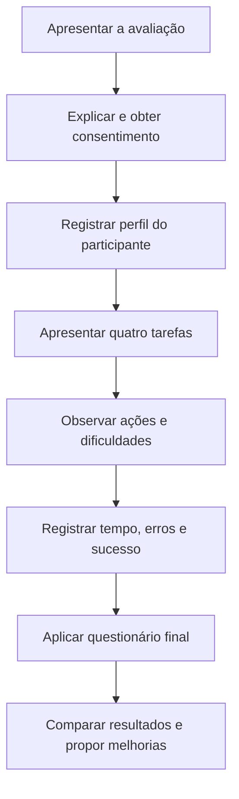

# Avaliação de Usabilidade por Observação do Usuário

**Exercício acadêmico com dados simulados.** Os três perfis, tempos, erros, graus de sucesso e respostas apresentados neste documento são exemplos criados para demonstrar o método, não medições reais.

## 1. Fluxograma de Avaliação por Observação

## 2. Procedimento de Preparação do Teste

**Passo 1: Preparação.**

Separar o protótipo do [LeituraJá no Figma](https://www.figma.com/design/NuB9Sp4ITmEvThTK4Lx7G9/LeituraJ%C3%A1---Prot%C3%B3tipos-Desktop-e-Celular?node-id=6-24) e conferir se as telas necessárias estão acessíveis.

**Passo 2: Lista de tarefas.**

O usuário deve identificar como:

1. Adicionar um livro à biblioteca.
2. Organizar um livro como **Quero ler**, **Lendo** ou **Lido**.
3. Atualizar o progresso de leitura.
4. Consultar o andamento de uma meta.

**Passo 3: Formulário de perfil do usuário.**

Registrar faixa etária, hábito de leitura e familiaridade com aplicativos.

**Passo 4: Orientações.**

Explicar que o objetivo é avaliar a interface, sem ensinar antecipadamente onde ficam as opções.

**Passo 5: Observação.**

Anotar a conclusão de cada tarefa, tempo, erros, dúvidas e reações observadas.

**Passo 6: Questionário.**

Perguntar se a navegação foi clara, se as tarefas foram fáceis e o que poderia melhorar.

**Passo 7: Resultados.**

Comparar os registros dos três usuários e organizar as melhorias por prioridade.

**Limite do protótipo:** como o Figma apresenta principalmente telas visuais, esta simulação considera o entendimento dos caminhos e das ações indicadas na interface, sem afirmar que os dados tenham sido realmente gravados em um sistema funcional.

## 3. Resultados do Teste

### 3.1 Usuário 1: perfil e observação simulados

**Perfil fictício:** 21 anos, universitário, lê algumas vezes por semana e utiliza aplicativos com frequência.

| Tarefa | Grau de sucesso | Total de erros | Tipos de erros | Tempo necessário | Grau de satisfação |
| :--- | :--- | :---: | :--- | :---: | :--- |
| **1. Adicionar livro** | Sucesso | 0 | Nenhum | **18 s** | Satisfeito |
| **2. Organizar biblioteca** | Sucesso parcial | 1 | Dúvida sobre onde alterar o status | **33 s** | Confusão leve |
| **3. Atualizar progresso** | Sucesso parcial | 1 | Dificuldade para localizar a ação | **42 s** | Confusão moderada |
| **4. Consultar metas** | Sucesso | 0 | Nenhum | **14 s** | Satisfeito |

**Resposta simulada ao questionário:** a página inicial é fácil de entender, mas a alteração do status e do progresso de leitura deveria ficar mais evidente.

**Conclusão individual:** o usuário encontrou as seções principais, mas precisou de mais tempo para compreender ações dentro da biblioteca.

### 3.2 Usuário 2: perfil e observação simulados

**Perfil fictício:** 23 anos, trabalha e estuda, lê ocasionalmente e usa mais o celular.

| Tarefa | Grau de sucesso | Total de erros | Tipos de erros | Tempo necessário | Grau de satisfação |
| :--- | :--- | :---: | :--- | :---: | :--- |
| **1. Adicionar livro** | Sucesso | 0 | Nenhum | **21 s** | Satisfeito |
| **2. Organizar biblioteca** | Sucesso parcial | 2 | Confusão entre filtro e alteração de status | **49 s** | Confusão moderada |
| **3. Atualizar progresso** | Sucesso parcial | 1 | Não identificou inicialmente o caminho | **45 s** | Confusão moderada |
| **4. Consultar metas** | Sucesso | 0 | Nenhum | **16 s** | Satisfeito |

**Resposta simulada ao questionário:** o aplicativo parece organizado e a área de metas é clara. Seria útil ter um botão específico para editar um livro.

**Conclusão individual:** a navegação principal foi compreendida, mas os controles da biblioteca precisam ser mais diretos.

### 3.3 Usuário 3: perfil e observação simulados

**Perfil fictício:** 20 anos, universitário, lê diariamente e já utiliza plataformas de organização de livros.

| Tarefa | Grau de sucesso | Total de erros | Tipos de erros | Tempo necessário | Grau de satisfação |
| :--- | :--- | :---: | :--- | :---: | :--- |
| **1. Adicionar livro** | Sucesso | 0 | Nenhum | **12 s** | Muito satisfeito |
| **2. Organizar biblioteca** | Sucesso | 0 | Nenhum | **19 s** | Satisfeito |
| **3. Atualizar progresso** | Sucesso parcial | 1 | Dúvida sobre como confirmar a alteração | **27 s** | Confusão leve |
| **4. Consultar metas** | Sucesso | 0 | Nenhum | **10 s** | Muito satisfeito |

**Resposta simulada ao questionário:** a separação dos livros e o acompanhamento das metas são fáceis de entender. Faltou um retorno mais claro após atualizar o progresso.

**Conclusão individual:** a experiência foi mais rápida, mas a interface ainda pode apresentar melhor o salvamento das alterações.

### 3.4 Resumo dos resultados simulados

| Indicador | Resultado |
| :--- | :--- |
| Participantes representados | **3 perfis fictícios** |
| Tarefas analisadas | **4 por perfil (12 registros)** |
| Sucessos completos | **7 de 12** |
| Sucessos parciais | **5 de 12** |
| Erros observados na simulação | **6** |
| Tempo total dos registros | **306 segundos** |
| Tempo médio por tarefa | **25,5 segundos** |
| Tarefas mais difíceis | **Organizar biblioteca e atualizar progresso** |

A quantidade de erros inclui dúvidas registradas como erros de compreensão ou de localização da ação. Os valores não são resultados reais de pesquisa.

## 4. Respostas do Formulário do Usuário

Resumo das respostas simuladas:

| Questão | Síntese das respostas |
| :--- | :--- |
| A navegação é fácil? | Os três perfis entenderam as páginas principais. |
| A organização dos livros está clara? | As categorias foram compreendidas, mas a edição do status gerou dúvidas. |
| O progresso de leitura é fácil de atualizar? | Foi o ponto com mais dificuldade de compreensão. |
| As metas são fáceis de consultar? | A área de metas foi considerada clara nos três exemplos. |
| O que melhorar? | Destacar edição de livros, atualização de páginas e confirmação das alterações. |

## 5. Conclusão da Avaliação por Observação

A simulação mostra que a estrutura principal do LeituraJá é simples, principalmente no acesso à biblioteca e às metas.

A maior oportunidade de melhoria está nas ações de **alterar a situação de um livro** e **atualizar o progresso**, que deveriam aparecer de forma mais direta.

Como próximos ajustes de interface, propõe-se destacar esses botões, incluir confirmações após salvar alterações e manter os mesmos padrões no computador e no celular.
