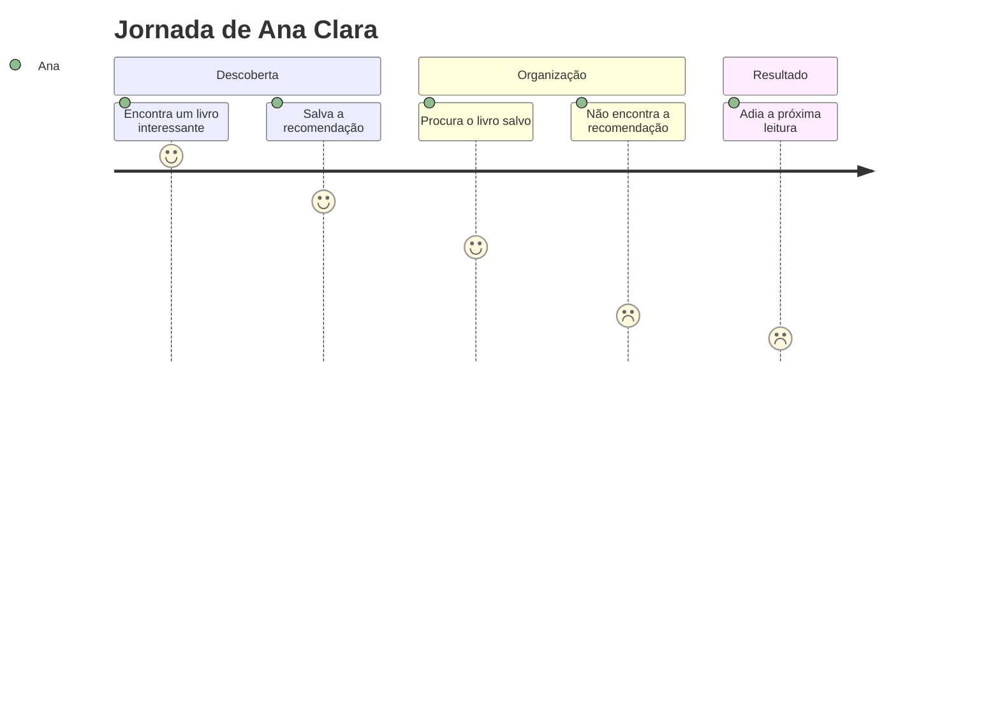

# Cenário de Análise/Problema

## 1. Cenário de Análise/Problema

Ana Clara tem 22 anos, é estudante universitária e gosta de ler durante seu tempo livre. Ela costuma encontrar recomendações de livros nas redes sociais e com amigos, salvando os títulos em anotações no celular ou em conversas.

Com o passar do tempo, essas recomendações ficam espalhadas em diferentes lugares. Quando Ana decide começar uma nova leitura, muitas vezes não consegue encontrar os livros que havia salvado. Além disso, ela tem dificuldade para lembrar quais livros já terminou e quais ainda pretende ler.

Essa falta de organização acaba dificultando a escolha de novas leituras e faz com que Ana perca tempo procurando informações que já havia registrado.

## 2. Questões de Refinamento

1. Com que frequência Ana esquece os livros que salvou?
2. Onde ela costuma registrar suas recomendações?
3. Por que Ana não utiliza uma única ferramenta para organizar suas leituras?
4. Ela já tentou utilizar algum aplicativo de organização de livros?
5. Como essa dificuldade interfere em seus hábitos de leitura?

## 3. Refinamento do Cenário de Análise/Problema

Ana Clara costuma descobrir novos livros por meio de recomendações de amigos e publicações nas redes sociais. Como utiliza diferentes formas de guardar essas informações, suas listas acabam ficando desorganizadas.

Quando tem tempo livre para ler, Ana procura suas anotações e mensagens antigas para decidir qual livro começar. Muitas vezes, não encontra o título desejado ou não lembra se já realizou aquela leitura.

Ela também gostaria de acompanhar melhor os livros que termina, mas não mantém um registro atualizado. Com isso, acaba perdendo tempo procurando informações e sente dificuldade para organizar suas próximas leituras.

## 4. Contexto de Uso

Ana utiliza principalmente o smartphone para acessar redes sociais, pesquisar livros e guardar recomendações.

**Contexto social:** recebe indicações de amigos e encontra sugestões de leitura nas redes sociais.

**Contexto econômico:** por ser universitária, precisa conciliar suas atividades acadêmicas com o tempo disponível para leitura.

**Contexto cultural:** possui interesse por livros e acompanha conteúdos relacionados à leitura no ambiente digital.

**Ambiente:** o problema acontece principalmente em casa, durante momentos livres ou quando Ana encontra recomendações enquanto utiliza o celular.

Normalmente, ela está realizando outras atividades quando encontra um livro interessante, o que contribui para salvar as informações rapidamente e sem muita organização.

## 5. Jornada do Usuário (atual, sem solução)

| Etapa | O que acontece | Estado emocional |
|---|---|---|
| 1. Descoberta | Ana encontra uma recomendação de livro nas redes sociais. | Animada |
| 2. Registro | Salva o título em uma anotação ou conversa no celular. | Confiante |
| 3. Busca | Depois de alguns dias, tenta encontrar o livro que havia salvado. | Confusa |
| 4. Dificuldade | Não encontra a recomendação entre suas anotações. | Frustrada |
| 5. Desistência | Desiste de procurar naquele momento e adia a escolha da próxima leitura. | Desmotivada |

### Diagrama da Jornada do Usuário

## Considerações finais

O cenário mostra que a principal dificuldade de Ana Clara está na falta de organização das informações sobre suas leituras.

Esse problema está relacionado às necessidades identificadas na pesquisa com usuários, principalmente ao controle dos livros lidos, à organização das recomendações e à dificuldade para escolher a próxima leitura.
