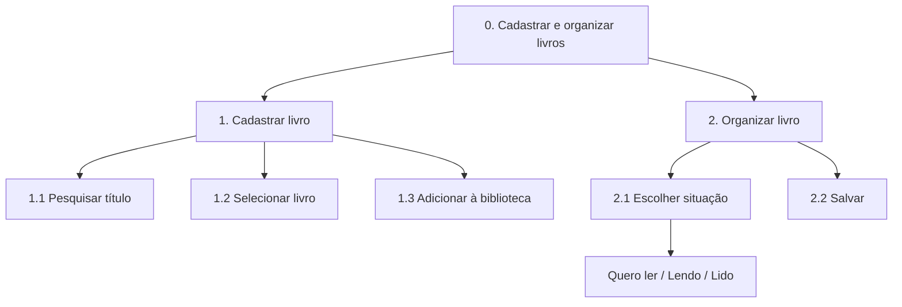

# Análise de Tarefas

## 1. HTA (Hierarchical Task Analysis)

### HTA: Cadastrar e organizar livros

O HTA apresenta as etapas para adicionar um livro à biblioteca e definir sua situação de leitura.



**Plano 0 (1>2):** cadastrar o livro e depois organizar sua situação.

**Plano 1 (1>2>3):** pesquisar, selecionar e adicionar o livro.

**Plano 2 (1>2):** escolher a situação e salvar.

**Plano 2.1 (1/2/3):** escolher entre quero ler, lendo ou lido.

## 2. GOMS (Goals, Operators, Methods, Selection Rules)

### GOMS: Atualizar progresso de leitura

O usuário acessa um livro e registra a página em que parou.

```text
GOAL 0: Atualizar o progresso de leitura

  GOAL 1: Acessar o livro

    METHOD 1.A: Pela biblioteca
    (SEL. RULE: livro disponível na biblioteca)
      OP. 1.A.1: Abrir "Minha biblioteca"
      OP. 1.A.2: Selecionar o livro

    METHOD 1.B: Pela pesquisa
    (SEL. RULE: livro não localizado na lista)
      OP. 1.B.1: Abrir a pesquisa
      OP. 1.B.2: Digitar o título
      OP. 1.B.3: Selecionar o livro

  GOAL 2: Registrar progresso

    METHOD 2.A: Atualizar páginas
      OP. 2.A.1: Clicar em "Atualizar progresso"
      OP. 2.A.2: Informar a página atual
      OP. 2.A.3: Salvar
```

### GOMS: Consultar metas de leitura

O usuário acessa a área de metas para verificar seu desempenho.

```text
GOAL 0: Consultar metas de leitura

  GOAL 1: Acessar metas

    METHOD 1.A: Pelo menu principal
      OP. 1.A.1: Clicar em "Metas"

  GOAL 2: Consultar progresso

    METHOD 2.A: Visualizar informações
      OP. 2.A.1: Selecionar a meta
      OP. 2.A.2: Verificar livros concluídos
      OP. 2.A.3: Consultar o progresso
```

## 3. Considerações finais

O HTA mostra como cadastrar e organizar livros, enquanto o GOMS detalha as ações para atualizar o progresso e consultar metas. Essa análise ajuda a definir as funcionalidades e a navegação da plataforma.
