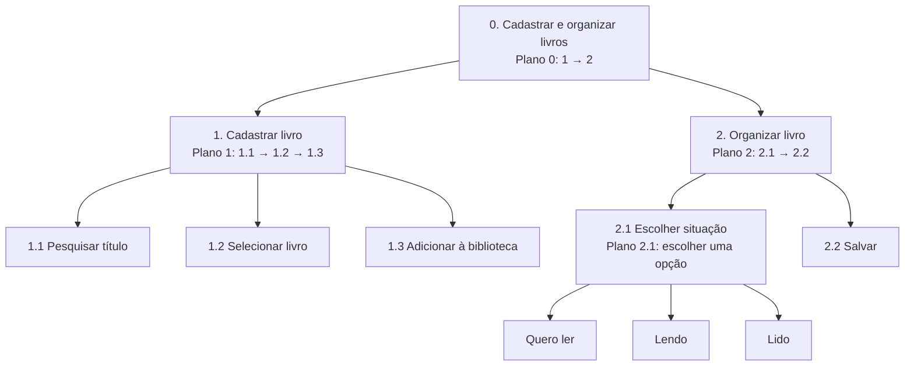

# Análise de Tarefas

## 1. HTA (Hierarchical Task Analysis)

### HTA: Cadastrar e organizar livros

O HTA mostra as etapas para cadastrar um livro no LeituraJá e organizar sua situação de leitura.



## 2. GOMS (Goals, Operators, Methods, Selection Rules)

### GOMS: Atualizar progresso de leitura

O usuário acessa um livro e informa a página em que parou.

```text
GOAL 0: Atualizar progresso de leitura

  GOAL 1: Acessar o livro

    METHOD 1.A: Pela biblioteca
      OP. 1.A.1: Abrir "Minha biblioteca"
      OP. 1.A.2: Selecionar o livro

    METHOD 1.B: Pela pesquisa
      OP. 1.B.1: Pesquisar o título
      OP. 1.B.2: Selecionar o livro

    SEL. RULE: Utilizar a pesquisa caso
    o livro não seja encontrado na lista.

  GOAL 2: Registrar progresso

    METHOD 2.A: Atualizar páginas
      OP. 2.A.1: Clicar em "Atualizar progresso"
      OP. 2.A.2: Informar a página atual
      OP. 2.A.3: Salvar
```

### GOMS: Consultar metas de leitura

O usuário acessa a página de metas para acompanhar seu desempenho.

```text
GOAL 0: Consultar metas de leitura

  GOAL 1: Acessar metas

    METHOD 1.A: Pelo menu principal
      OP. 1.A.1: Clicar em "Metas"

  GOAL 2: Consultar progresso

    METHOD 2.A: Visualizar informações
      OP. 2.A.1: Selecionar a meta
      OP. 2.A.2: Verificar livros concluídos
      OP. 2.A.3: Consultar o progresso
```

## 3. Considerações Finais

O HTA apresenta as etapas para cadastrar e organizar livros. Já o GOMS mostra as ações para atualizar o progresso e consultar metas. Essas análises ajudam a organizar as funcionalidades do LeituraJá.
