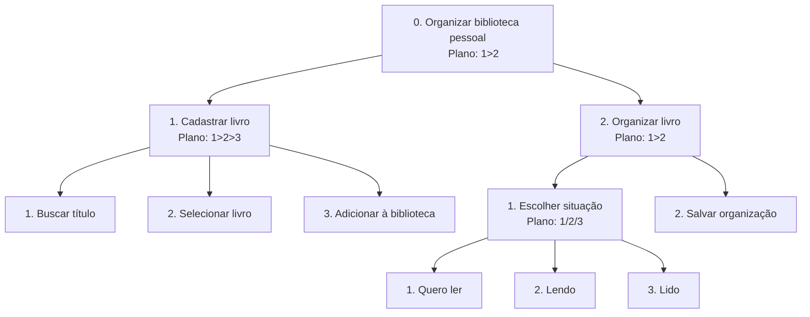

# Análise de Tarefas

## 1. HTA (Hierarchical Task Analysis)

### HTA: Cadastrar e organizar livros

**Funcionalidade:** permitir que o usuário cadastre livros em sua biblioteca pessoal e organize cada título de acordo com sua situação de leitura.

O objetivo é facilitar o registro dos livros que o usuário deseja ler, está lendo ou já terminou.



**Plano 0 (1>2):** primeiro o usuário cadastra o livro e depois organiza sua situação de leitura.

**Plano 1 (1>2>3):** pesquisa o título, seleciona o livro encontrado e adiciona à biblioteca.

**Plano 2 (1>2):** escolhe a situação de leitura e salva a informação.

**Plano 2.1 (1/2/3):** seleciona uma das três situações disponíveis: quero ler, lendo ou lido.

## 2. GOMS (Goals, Operators, Methods, Selection Rules)

### GOMS: Atualizar o progresso de leitura

**Funcionalidade:** permitir que o usuário registre seu avanço em um livro, acompanhando a quantidade de páginas lidas.

```text
GOAL 0: atualizar o progresso de leitura de um livro

  GOAL 1: acessar o livro desejado

    METHOD 1.A: acessar pela biblioteca
    (SEL. RULE: o usuário está na tela inicial)
      OP. 1.A.1: clicar na opção "Minha biblioteca"
      OP. 1.A.2: localizar o livro na lista
      OP. 1.A.3: clicar no livro desejado

    METHOD 1.B: utilizar a pesquisa
    (SEL. RULE: o usuário não encontra o livro na lista)
      OP. 1.B.1: clicar no campo de pesquisa
      OP. 1.B.2: digitar o título do livro
      OP. 1.B.3: selecionar o resultado encontrado

  GOAL 2: registrar o progresso

    METHOD 2.A: atualizar as páginas lidas
      OP. 2.A.1: clicar em "Atualizar progresso"
      OP. 2.A.2: digitar a página atual
      OP. 2.A.3: clicar em "Salvar"
      OP. 2.A.4: verificar o progresso atualizado
```

### GOMS: Consultar metas de leitura

**Funcionalidade:** permitir que o usuário consulte suas metas de leitura e visualize quantos livros já concluiu durante o período.

```text
GOAL 0: consultar o acompanhamento das metas

  GOAL 1: acessar a área de metas

    METHOD 1.A: acessar pelo menu principal
      OP. 1.A.1: clicar na opção "Metas"
      OP. 1.A.2: aguardar o carregamento das informações

  GOAL 2: visualizar o desempenho

    METHOD 2.A: consultar o resumo da meta
      OP. 2.A.1: localizar a meta cadastrada
      OP. 2.A.2: verificar a quantidade de livros concluídos
      OP. 2.A.3: visualizar o progresso apresentado
```

## 3. Considerações finais

A análise de tarefas permitiu organizar as principais ações que os usuários deverão realizar na plataforma.

O HTA apresentou as etapas necessárias para cadastrar e organizar livros, enquanto o GOMS detalhou as ações para atualizar o progresso e consultar metas de leitura.

Esses modelos ajudam a entender como as funcionalidades devem ser estruturadas, facilitando o desenvolvimento da arquitetura de informação e dos fluxos de navegação nas próximas etapas.
