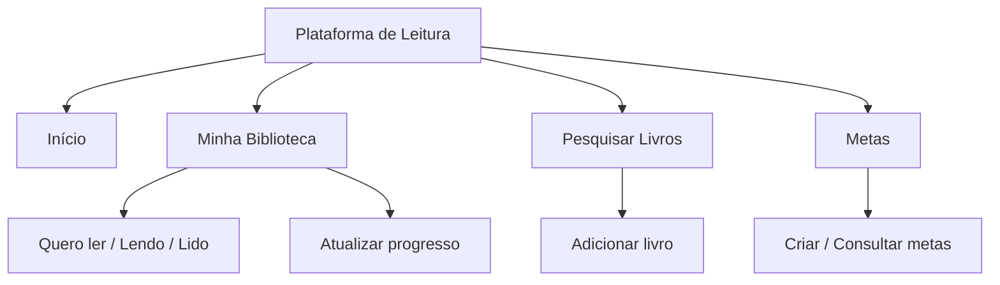
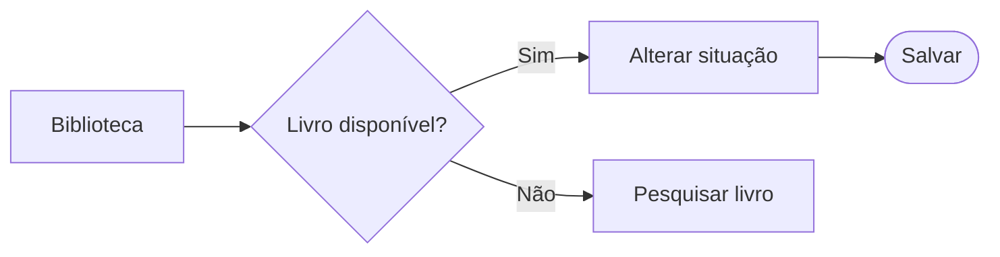
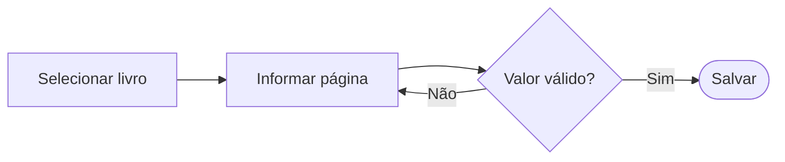
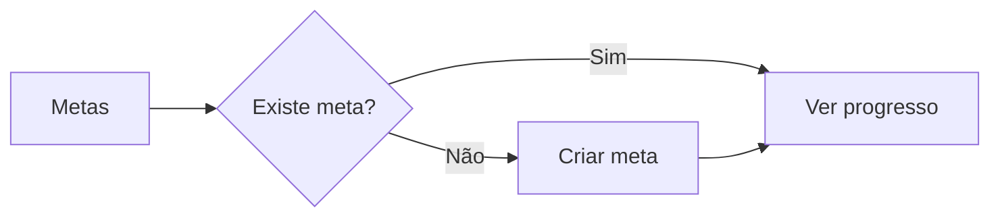

# Arquitetura de Informação e Fluxo do Usuário

## 1. Arquitetura de Informação

A plataforma foi organizada para que o usuário consiga encontrar seus livros, acompanhar leituras e consultar metas de forma simples.

## 2. Fluxo do Usuário

### 2.1 Cadastrar livro

O usuário pesquisa um título e adiciona à biblioteca.

### 2.2 Organizar biblioteca

O usuário seleciona um livro e altera sua situação de leitura.

### 2.3 Atualizar progresso

O usuário informa a página atual do livro.

### 2.4 Consultar metas

O usuário acessa suas metas para verificar o progresso.

## 3. Considerações finais

Os fluxos mostram como o usuário poderá realizar as principais tarefas da plataforma. A ideia é manter uma navegação simples, com poucas etapas e acesso rápido às funcionalidades.
