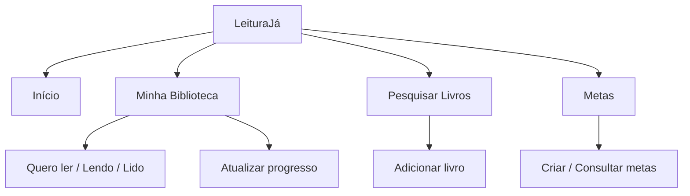
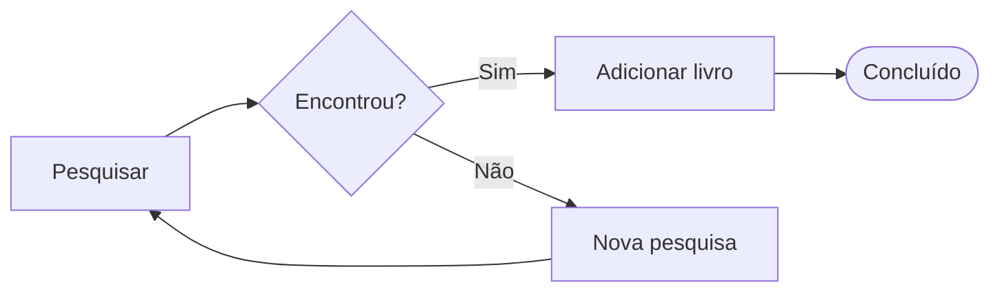
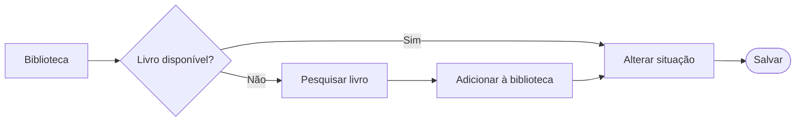
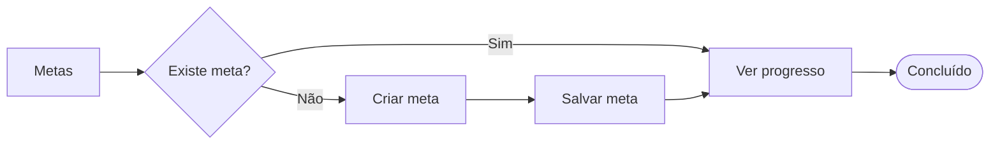

# Arquitetura de Informação e Fluxo do Usuário

## 1. Arquitetura de Informação

O LeituraJá foi organizado para que o usuário consiga encontrar seus livros, acompanhar suas leituras e consultar suas metas de forma simples.

## 2. Fluxo do Usuário

### 2.1 Cadastrar livro

O usuário pesquisa um título e adiciona o livro à biblioteca.

### 2.2 Organizar biblioteca

O usuário seleciona um livro e altera sua situação de leitura. Se o livro não estiver na biblioteca, deverá adicioná-lo primeiro.

### 2.3 Atualizar progresso

O usuário informa a página atual do livro.

### 2.4 Consultar metas

O usuário acessa suas metas para verificar seu progresso. Caso não tenha uma meta cadastrada, poderá criar uma.

## 3. Considerações Finais

Os fluxos mostram as principais tarefas que o usuário poderá realizar no LeituraJá. A ideia é manter uma navegação simples, com poucas etapas e acesso rápido às funcionalidades.
